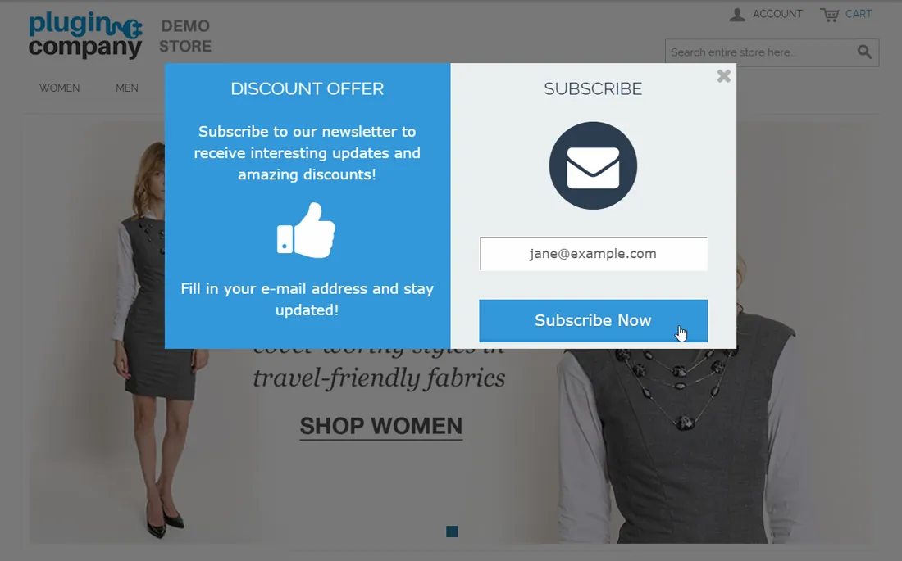
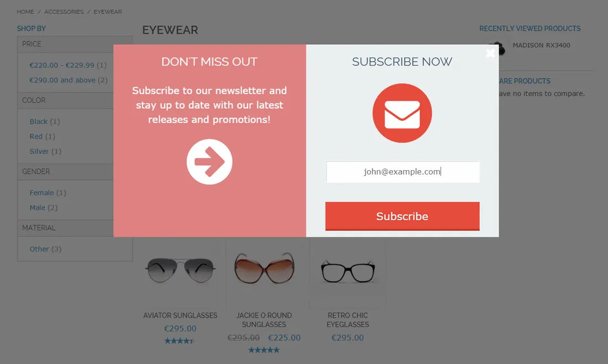
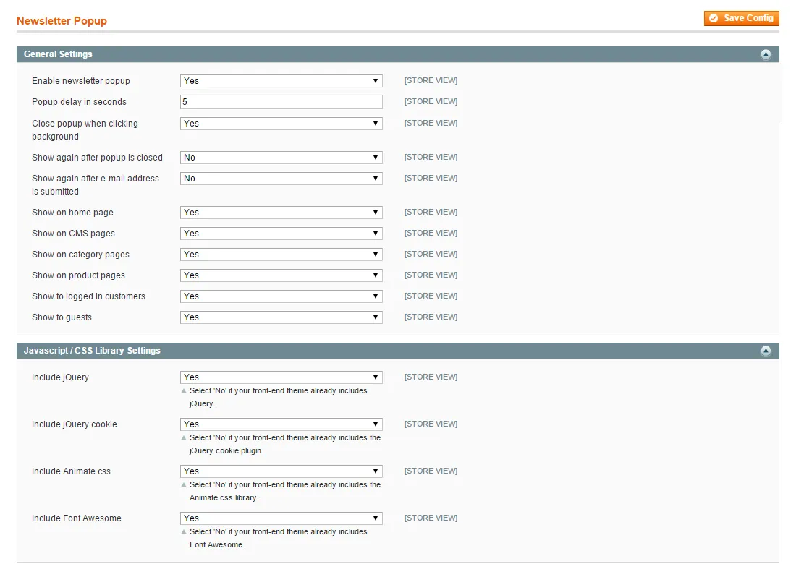
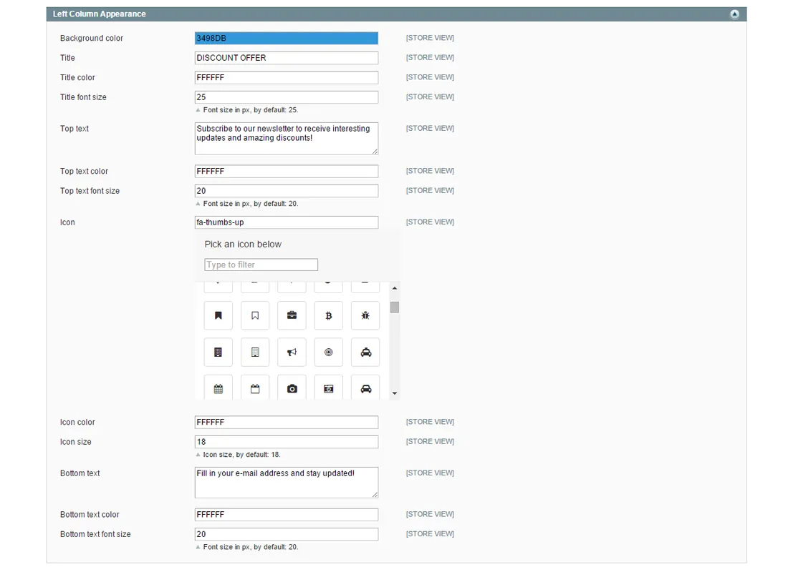
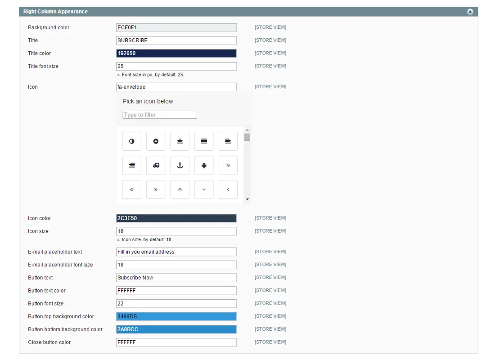

# Newsletter Pop-up for Magento 1 / OpenMage

**Animated newsletter subscription pop-up for Magento.**



Shows an animated pop-up that invites visitors to subscribe to your newsletter.

Design, texts and display rules are configured in the Magento admin.

> [!NOTE]
> Newsletter Pop-up is free and open source under the MIT License (since 2026). Plugin Company no longer actively develops this extension, but issues and pull requests are welcome.

## Features

- Animated newsletter subscription pop-up
- Configurable design and display options
- Custom titles, texts and placeholder
- Color pickers for all colors
- Choice of Font Awesome icons
- Choose when and on which pages the pop-up appears
- Show to logged-in customers and/or guests

## Screenshots

<table>
  <tr>
    <td width="50%" valign="top"><br><sub>Newsletter pop-up front-end example (2 of 4)</sub></td>
    <td width="50%" valign="top"><br><sub>Newsletter pop-up front-end example (3 of 4)</sub></td>
  </tr>
  <tr>
    <td width="50%" valign="top"><br><sub>Newsletter pop-up front-end example (4 of 4)</sub></td>
    <td width="50%" valign="top"><br><sub>Front-end display settings</sub></td>
  </tr>
  <tr>
    <td width="50%" valign="top"><br><sub>Left column appearance</sub></td>
    <td width="50%" valign="top"><br><sub>Right column appearance</sub></td>
  </tr>
</table>

More screenshots are on the [product page](https://plugin.company/magento1-extensions/newsletter-pop-up.html).

## Compatibility

- **Magento:** Community Edition 1.4.x – 1.9.x, Enterprise Edition 1.8.x – 1.14.x
- **Latest version:** 1.1.0 (released 2016-05-01)
- **Composer package:** `plugincompany/magento1-newsletter-popup`
- **Module:** `Plugincompany_Newsletterpopup`

## Installation

### modman

```bash
cd /path/to/magento
modman init   # once per Magento installation
modman clone https://github.com/PluginCompany/magento1-newsletter-popup.git
```

modman creates symlinks, so enable *Allow Symlinks* under System > Configuration > Advanced > Developer > Template Settings.

### Composer

With [magento-hackathon/magento-composer-installer](https://github.com/Cotya/magento-composer-installer) (it reads the `modman` file of this repository):

```bash
composer config repositories.plugin.company composer https://plugin.company/
composer require plugincompany/magento1-newsletter-popup
```

Your project `composer.json` needs the Magento root directory in its `extra` section (and, with Composer 2.2+, the installer plugin allowed), for example:

```json
{
    "extra": { "magento-root-dir": "./" },
    "config": { "allow-plugins": { "magento-hackathon/magento-composer-installer": true } }
}
```

### Manual installation

Download the ZIP of the latest release from the [tags page](https://github.com/PluginCompany/magento1-newsletter-popup/tags) ([1.1.0](https://github.com/PluginCompany/magento1-newsletter-popup/archive/refs/tags/1.1.0.zip)) and copy the `app/`, `js/` folders into your Magento root:

```bash
unzip magento1-newsletter-popup-1.1.0.zip
cp -R magento1-newsletter-popup-1.1.0/app magento1-newsletter-popup-1.1.0/js /path/to/magento/
```

Step-by-step instructions are in the [installation guide](docs/02-installing-the-magento-extension.md).

### After installing

Clear the cache (System > Cache Management, or `rm -rf var/cache/*`), then log out of the admin and log in again so the new configuration sections and permissions are loaded.

> [!NOTE]
> Some files of this extension are also shipped by other Plugin Company Magento 1 extensions: `js/plugincompany/jquerynoconflict.js` (also in 8 other extensions); `js/plugincompany/lib/animate.min.css` (also in magento1-custom-contact-forms); `js/plugincompany/lib/fontawesome` (also in magento1-easy-menu); `js/plugincompany/lib/jscolor` (also in magento1-custom-contact-forms). The original ZIP packages simply overwrote each other's copy; with modman or the Composer installer the second extension reports an existing target for these paths.

### Upgrading from a purchased copy

Replace the old files with this release. No license key is needed; your settings and data stay as they are.

## Documentation

- [Documentation in this repository](docs/README.md) (Installation Guide, User Manual)
- Online documentation: <https://plugin.company/knowledge-base/docs/magento-newsletter-popup/>
- Product page: <https://plugin.company/magento1-extensions/newsletter-pop-up.html>

## Changelog

See [CHANGELOG.md](CHANGELOG.md) for the release history.

## Contributing

Found a bug or have an improvement? Please open an [issue](https://github.com/PluginCompany/magento1-newsletter-popup/issues) or send a [pull request](https://github.com/PluginCompany/magento1-newsletter-popup/pulls). Since the extension is no longer actively developed by Plugin Company, fixes from the community are the best way to keep it working on current Magento 1 / OpenMage and PHP versions.

## License

Plugin Company's code in this repository is released under the [MIT License](LICENSE), Copyright (c) 2014-2026 Plugin Company.

Bundled third-party libraries keep their own licenses; see [THIRD-PARTY-NOTICES.md](THIRD-PARTY-NOTICES.md) for the full list.

In particular:

- **jscolor 1.4.4** (`js/plugincompany/lib/jscolor/`) is licensed under **LGPL** (GNU Lesser General Public License, version not stated), not MIT.
