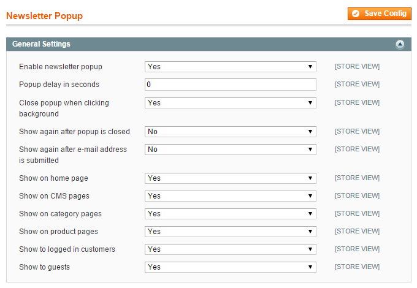
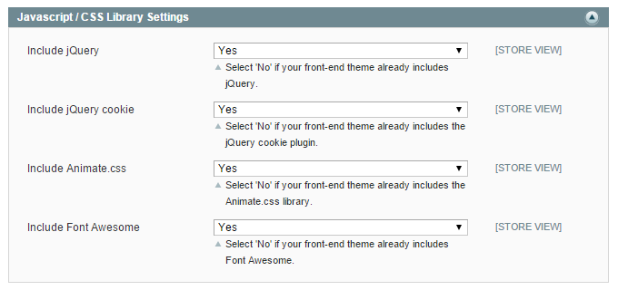
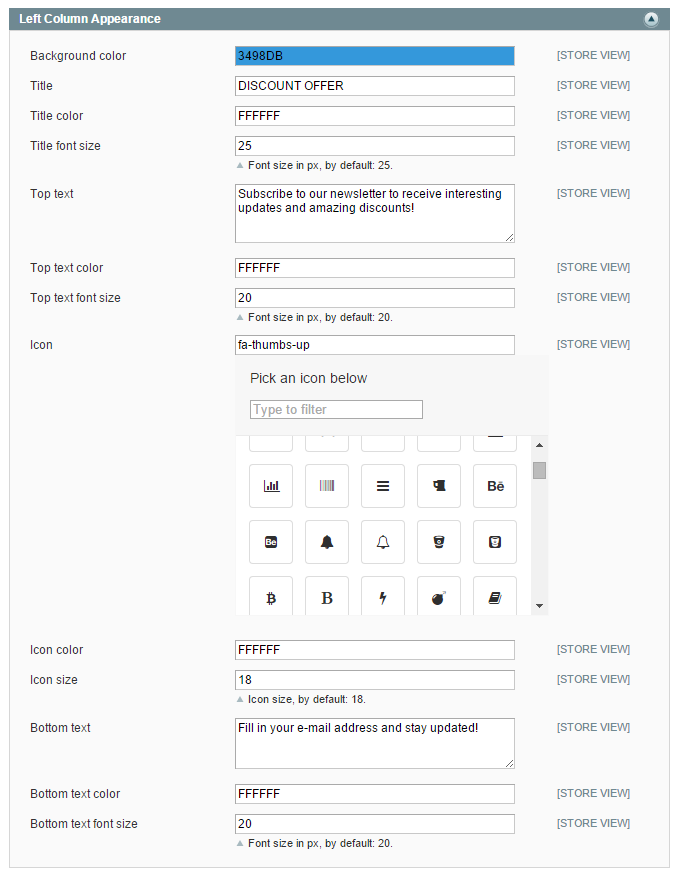
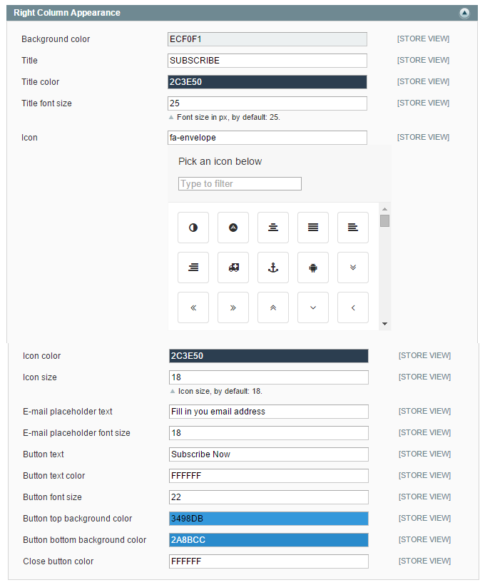

# Configuring the Newsletter Pop-up Extension

To configure the extension, navigate to **Newsletter > Newsletter Popup** in the top Admin Panel menu or go to **System > Configuration** and select **Newsletter Popup** from the left side menu.

Using the config screen you can modify the extension's general settings and customize the newsletter pop-up front-end appearance as further explained below.

It’s possible to configure the extension per store view by changing the 'Current Configuration Scope' at the top left corner of the page.

To save any changes made in the Newsletter Pop-up settings, click the 'Save Config' button in the top right corner of the configuration page.

## General Settings

In the extension's General Settings you can:

- Enable the newsletter pop-up.
- Define the pop-up delay in seconds when a store page is opened.
- Choose whether the pop-up can be closed by clicking the page background.
- Choose whether the pop-up should re-appear after it has been closed (and the page is reloaded again) or when an e-mail address is submitted.
- Select on which pages(s) the newsletter pop-up should be displayed.
- Choose to show the pop-up to logged in customers and/or guests.

## Javascript / CSS Library Settings

In this section you can choose to use the extension's Javascript, CSS and Font Awesome libraries.

Select 'No' if your Magento theme already includes one of these libraries.

## Front-end Appearance

In the bottom sections of the configuration screen you can customize the front-end appearance of the newsletter pop-up's left and right column.

You can change the titles and text content and adjust the font size (which should be entered without the px suffix).

Background, font, icon and button colors can be adjusted using the built-in color picker or by entering the color code (without the # prefix).

You can select icons from the integrated Font Awesome library and change their color and size.

### Left Column Appearance

### Right Column Appearance

---

[Documentation index](./README.md) · [README](../README.md) · [Online version](https://plugin.company/knowledge-base/docs/magento-newsletter-popup/user-manual/configuring-the-newsletter-popup-extension/)
